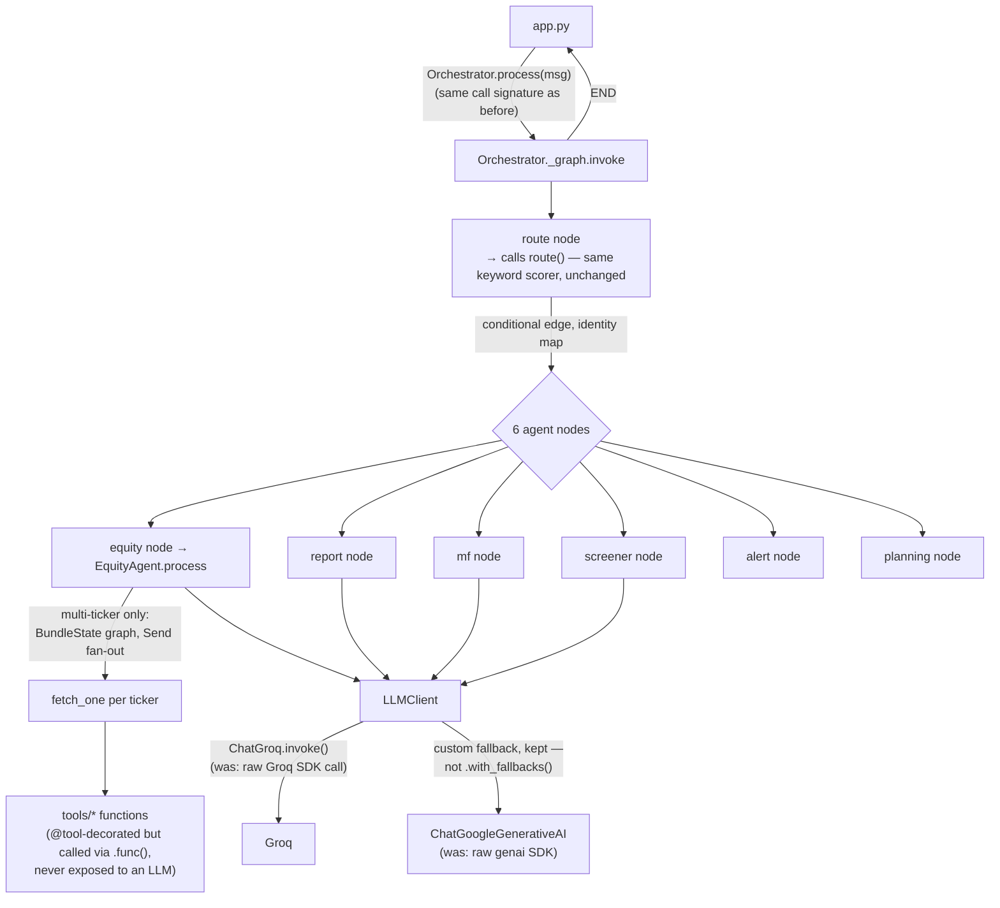

# ARIA — `langchain-langgraph-migration` Branch Report

*Branch: `langchain-langgraph-migration` · 1 commit ahead of `main` (`d4cdd55` "Migrate orchestrator routing to LangGraph StateGraph")*
*Compared against the pre-migration architecture documented in `ARIA_ARCHITECTURE_REPORT.md`.*

> **Headline verdict**: this is a **surface-level LangChain/LangGraph adoption layered over an unchanged deterministic architecture**, not a functional rewrite. Routing logic, prompt text, and business logic are preserved byte-for-byte in almost every file; the diff is dominated by typing/wrapping exercises. One piece of scaffolding (`@tool` decorators across ~40 functions) is currently inert — added but never connected to an LLM. Full breakdown and file-by-file evidence below.

---

## 1. Scope of the Change

21 files touched, 743 insertions / 567 deletions. New deps: `langchain-core>=0.3.0`, `langchain-groq>=0.2.0`, `langchain-google-genai>=2.0.0`, `langgraph>=0.2.0` — added *alongside* the original `groq` and `google-genai` SDKs, not replacing them. No new files (no `graph.py`/`state.py`/`tools.py`/`nodes.py` — all StateGraph code lives inline in `orchestrator.py` and `equity_agent.py`). No `.env.example`/config changes — no new required env vars.

---

## 2. What Actually Changed, By Component

### 2a. Orchestrator routing → wrapped in a `StateGraph`, logic unchanged

`agents/orchestrator.py::route()` — the deterministic keyword-scoring function (`_REPORT_KW`/`_SCREENER_KW`/`_MF_KW`/`_ALERT_KW`/`_PLANNING_KW`, `_ALERT_CRUD_RE`) — is **100% unchanged**. It is now called from inside a graph node instead of directly:

```python
class _RouteState(TypedDict, total=False):
    message: str
    tab: str
    text: str
    chart: object
    pdf_path: Optional[str]
    md_path: Optional[str]
    csv_path: Optional[str]

def route_node(state): return {"tab": route(state["message"], last_tab=self._last_tab)}
def make_agent_node(tab_name):
    def node(state):
        agent = self._agents[tab_name]
        text, chart = agent.process(message)
        ...
    return node

g = StateGraph(_RouteState)
g.add_node("route", route_node)
for tab in _TABS: g.add_node(tab, make_agent_node(tab))
g.add_edge(START, "route")
g.add_conditional_edges("route", lambda s: s["tab"], {t: t for t in _TABS})
for tab in _TABS: g.add_edge(tab, END)
```

`_TABS = ["equity", "report", "mf", "screener", "alert", "planning"]` — 1 route node + 6 agent nodes, one conditional edge whose mapping is the identity function (`{t: t for t in _TABS}`) — i.e. functionally the same `if/elif` dispatch expressed as graph edges. The orchestrator's own docstring says this outright: routing is still the same deterministic keyword scoring, "just expressed as graph edges instead of Python branching."

`Orchestrator.process()` now does a single synchronous `self._graph.invoke({"message": message})` — **no streaming at the graph level** (previously `process_stream()` yielded incrementally for EquityAgent). Whether an individual agent still streams internally is unchanged; that capability is just no longer surfaced through the graph invocation.

`alert_agent.py` and `planning_agent.py` are wired in as graph nodes with **zero code changes** — their `.process()` contract didn't need to move.

### 2b. `LLMClient` — real internal swap, kept custom control flow

`agents/llm_client.py`'s outer shape — `_KeyRotator`, the retry/backoff loop (`_call()`, `MAX_RETRIES`), and the Groq→Gemini fallback sequencing — is **structurally unchanged**. What changed is what's underneath each provider:

- `_GroqProvider`: `Groq(api_key=...).chat.completions.create(...)` → `ChatGroq(api_key=..., model=..., temperature=..., max_tokens=...).invoke(msgs)`. History moved from `list[dict]` to `list[BaseMessage]` (`HumanMessage`/`AIMessage`, `SystemMessage` prepended per call).
- `_GeminiProvider`: same pattern with `ChatGoogleGenerativeAI`.
- Key rotation (`_groq_rotator.next()`) is called identically — just handed to `ChatGroq(api_key=...)` instead of the raw SDK client. **Rotation behavior unchanged.**
- Fallback is **deliberately not** LangChain's `.with_fallbacks()`. Code comment explains why: the retry-then-fallback flow is stateful across calls (key rotation across attempts, then provider failover) in a way a single static fallback list doesn't model.

This is the one clearly reasoned, complete piece of the migration — LangChain chat models genuinely replace the raw SDK calls, while the surrounding control flow that actually matters (rotation, retry, fallback) is intentionally preserved rather than handed to LangChain.

### 2c. Specialist agents — prompts retyped, no tool-calling loop anywhere

None of `equity_agent.py`, `mf_agent.py`, `report_agent.py`, `screener_agent.py` became a LangChain `Tool`/`BaseTool`. Repo-wide grep for `bind_tools`, `ToolNode`, `.tool_calls`, `AgentExecutor` returns **zero hits**. Each agent is still a hand-written fetch-then-synthesize class; the only change is raw f-string prompts converted to `PromptTemplate.from_template(...)` piped through `RunnableLambda`:

```python
chain = self._synthesis_prompt | RunnableLambda(
    lambda pv: self._chat(pv.text, temperature=0.2, max_tokens=max_tokens)
)
llm_out = chain.invoke({"msg": msg, "guidance": guidance, "data_text": data_text, ...})
```

mf_agent.py: 7 such templates. report_agent.py: 4 (one per report type). screener_agent.py: 4. In every case diffed, **prompt text is verbatim identical** to the pre-migration f-string — this is a templating-style change, not a synthesis redesign.

**Exception — `equity_agent.py` gained a second, real `StateGraph`**: a map-reduce fan-out for multi-ticker fetches, replacing an ad-hoc `ThreadPoolExecutor` at that level:

```python
class BundleState(TypedDict):
    tickers: list[str]
    bundles: Annotated[list[dict], operator.add]
    errors: Annotated[list[str], operator.add]

def dispatch(state): return [Send("fetch_one", {"ticker": t}) for t in state["tickers"]]
def fetch_one(state):
    try:
        b = self._fetch_bundle(state["ticker"])
        return {"bundles": [b]} if b else {"errors": [f"{state['ticker']}: no market data"]}
    except Exception as e:
        return {"errors": [f"{state['ticker']}: {e}"]}

g = StateGraph(BundleState)
g.add_node("fetch_one", fetch_one)
g.add_conditional_edges(START, dispatch, ["fetch_one"])
g.add_edge("fetch_one", END)
```

This is the one place LangGraph's actual value-add (`Send`, dynamic parallel fan-out with `operator.add` reducers) does real work. Note it coexists with the *original* `ThreadPoolExecutor(max_workers=6)` still used one level deeper inside `_fetch_bundle()` for per-ticker sub-fetches — two different concurrency mechanisms now solve two different fan-out levels in the same file.

### 2d. `tools/` layer — `@tool` decorators added, but inert

This is the most important finding. Every changed line across `fundamental.py`, `risk.py`, `sentiment.py`, `backtester.py`, `amfi.py`, `fetcher.py`, `news_fetcher.py`, `nse_scraper.py`, `pdf_scraper.py` is one of two mechanical edits:

1. `@tool(description="...")` added above ~40 function signatures — **function bodies byte-for-byte unchanged**.
2. Every internal call site (75 total, verified by grep) rewritten from `fn(...)` to `fn.func(...)` to unwrap the decorator back to a plain callable.

Example:
```python
@tool(description="Fetch live quote/company info for an NSE/BSE ticker symbol (no suffix).")
def get_info(symbol: str) -> dict:
    ...
```
called everywhere as `get_info.func(sym)`.

`@tool` turns a plain function into a `langchain_core.tools.StructuredTool` — its entire purpose is to be handed to an LLM for autonomous tool selection (`bind_tools`, `AgentExecutor`, `ToolNode`). **Nowhere in this diff is a tool object ever passed to an LLM or a `ToolNode`.** Every call site immediately defeats the wrapper via `.func(...)`. This decoration currently does nothing — it's scaffolding for a future agentic-tool-selection step that was never wired up in this commit.

### 2e. `utils/helpers.py::llm_resolve_query()` — the one genuine logic replacement

The old manual approach — strip ` ```json ` fences, `json.loads(raw)`, dict `.get()` calls — was replaced with a real Pydantic schema + `PydanticOutputParser`:

```python
class _TickerIntent(BaseModel):
    ticker: Optional[str] = Field(default=None, description="Uppercase NSE ticker...")
    intent: str = Field(description="Exactly one of [...]")

parser = PydanticOutputParser(pydantic_object=_TickerIntent)
prompt = PromptTemplate(template="...{format_instructions}", ...).format(...)
parsed = parser.parse(raw)
ticker = clean_ticker(parsed.ticker.strip().upper()) if parsed.ticker else None
intent = parsed.intent if parsed.intent in _VALID_LLM_INTENTS else "chat"
```

This is the **only place LangChain machinery genuinely replaces bespoke parsing logic** rather than just wrapping existing behavior. The rest of `resolve_query()` — deterministic-first ticker resolution, `extract_all_entities()`, etc. — is untouched.

### 2f. `app.py` and `scripts/check_alerts.py` — mechanical follow-through only

`app.py`: 2 call sites updated to the `.func()` convention (`get_info.func(sym)`, `get_ohlcv.func(sym, "3mo", "1d")` in `_fetch_watchlist_table()`). **No change to how `app.py` talks to `Orchestrator`** — it still calls `Orchestrator.process()`, which now internally does `graph.invoke(...)`, but that's invisible to the UI layer.

`scripts/check_alerts.py`: same pattern, `get_bulk_deals(symbol)` → `get_bulk_deals.func(symbol)`.

### 2g. Memory/checkpointing — not touched

Repo-wide grep for `MemorySaver`, `checkpointer`, `thread_id` returns **zero hits**. The graph is compiled with `g.compile()` — no checkpointer argument — and invoked with no `config={"configurable": {"thread_id": ...}}`, so no state persists across invocations at the graph level. Whatever Postgres `chat_history` persistence exists outside this diff is completely unaffected — those files aren't in the changeset at all.

---

## 3. Diagram — Request Flow Under This Branch



---

## 4. Assessment

**What's real:**
- `LLMClient`'s provider layer genuinely moved to LangChain chat models (`ChatGroq`, `ChatGoogleGenerativeAI`), with the stateful retry/rotation/fallback logic deliberately kept outside LangChain's fallback mechanism — a reasoned decision, documented in code.
- `llm_resolve_query()`'s JSON parsing genuinely moved to a Pydantic schema + `PydanticOutputParser` — safer than manual fence-stripping and `json.loads`.
- `equity_agent.py`'s multi-ticker `BundleState` graph is a real (if narrow) use of LangGraph's fan-out (`Send`) for something the old `ThreadPoolExecutor` did — arguably a lateral move, not a clear improvement, since it now coexists with the original executor one level deeper.

**What's cosmetic:**
- Orchestrator routing: same keyword scorer, same dispatch outcome, now expressed as graph edges instead of `if/elif`. No LLM makes any routing decision.
- ~40 `@tool` decorators across the entire `tools/` layer are currently **dead weight** — every call site unwraps them via `.func()`, and no `AgentExecutor`/`ToolNode`/`bind_tools` ever consumes them. This is scaffolding for LLM-driven tool selection that was never connected.
- Prompt template conversions (`PromptTemplate.from_template`) preserve prompt text verbatim — a typing exercise, not a prompt-engineering change.
- Streaming was lost at the graph level (`process()` is now a single synchronous `invoke()`) without a documented replacement — worth flagging as a regression risk if EquityAgent's UI streaming depended on the old `process_stream()` path.

**Net read**: the branch name promises more than the diff delivers. It's an incremental, low-risk dependency swap (SDK → LangChain wrapper) plus unused agentic-tooling scaffolding, not a routing or reasoning redesign. Before merging, worth deciding explicitly whether the `@tool` decorations are (a) going to be finished — wire an `AgentExecutor`/`ToolNode` so the LLM actually picks tools, replacing the deterministic keyword router, or (b) stripped back out as unnecessary indirection if the deterministic router is being kept intentionally. Also worth restoring or explicitly deciding against streaming at the orchestrator level, since that's a user-facing regression versus `main`.

---

*Compiled from a git worktree checkout of `langchain-langgraph-migration` (commit `d4cdd55`), diffed against `main`, cross-referenced with `ARIA_ARCHITECTURE_REPORT.md`.*
