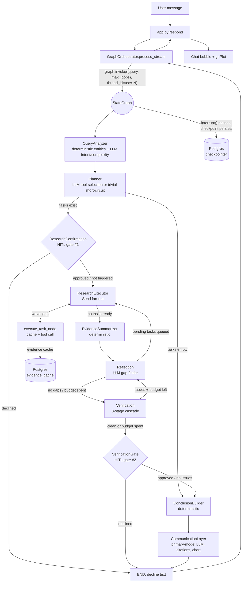

# ARIA — `langgraph` Branch: Architecture & End-to-End Query Workflow

*Branch: `langgraph` · latest commit `0e5919c` "Add GraphOrchestrator adapter behind USE_LANGGRAPH_ORCHESTRATOR flag"*

> This branch is a **genuine agentic rewrite**, not the cosmetic wrapping seen on `langchain-langgraph-migration` (see `ARIA_LANGGRAPH_MIGRATION_REPORT.md`). It replaces deterministic keyword-routed agents with an 11-node LangGraph `StateGraph`: query analysis → planning → parallel tool execution → evidence summarization → a reflection/verification self-correction loop → human-in-the-loop gates → conclusion building → LLM-authored, citation-grounded final response. It is fully feature-flagged behind `USE_LANGGRAPH_ORCHESTRATOR` (default **off**) so it runs alongside the existing production `Orchestrator` without risk.

---

## 1. Two Systems, One Switch

`app.py::get_orchestrator(user_id)`:

```python
def get_orchestrator(user_id: int):
    if user_id not in _orchestrators:
        from config import USE_LANGGRAPH_ORCHESTRATOR
        if USE_LANGGRAPH_ORCHESTRATOR:
            from agents.graph_orchestrator import GraphOrchestrator
            _orchestrators[user_id] = GraphOrchestrator(user_id)
        else:
            from agents.orchestrator import Orchestrator
            _orchestrators[user_id] = Orchestrator(user_id)
    return _orchestrators[user_id]
```

`USE_LANGGRAPH_ORCHESTRATOR = os.getenv("USE_LANGGRAPH_ORCHESTRATOR", "false").lower() == "true"` (`config.py:32`) — default off, one instance cached per `user_id`, so a flag flip only affects new sessions. Both orchestrators expose the same `process_stream(message)` call surface, so `app.py`'s `respond()` never branches on which backend is active. **Known gap**: `_load_session` unconditionally calls `.load_history(hist)` when reopening a past chat — `GraphOrchestrator` has no such method, so resuming an old session under the flag would raise `AttributeError`. Not yet patched.

This report covers the **`GraphOrchestrator`** path. The legacy `Orchestrator` path is documented in `ARIA_ARCHITECTURE_REPORT.md`.

---

## 2. Overall Diagram



---

## 3. State — What Flows Through the Graph

`graph/state.py::GraphState` (`TypedDict`), the single object every node reads and partially updates:

```python
class GraphState(TypedDict):
    messages: Annotated[list, add_messages]
    query: str
    entities: list[str]
    intent: str
    objective: str
    complexity: str
    plan: ResearchPlan
    tasks: Annotated[list[Task], upsert_by_id]
    evidence: Annotated[list[Evidence], append_dedup]
    evidence_summary: dict
    missing_info: list[MissingInfoItem]
    verification_issues: list[VerificationIssue]
    conclusions: list[Conclusion]
    loop_count: Annotated[int, operator.add]
    max_loops: int
    confidence_summary: dict
    research_journal: Annotated[list[JournalEntry], operator.add]
    final_report: str
    chart_html: str
```

Custom reducers govern how concurrent node returns merge:
- `tasks` → `upsert_by_id`: merge by `Task["id"]`, never clobbers a `done` task.
- `evidence` → `append_dedup`: dedup on `(source, entity, evidence_type, citation_key)`.
- `loop_count` → `operator.add`: shared budget counter, incremented by **both** Reflection and Verification.
- `research_journal` → `operator.add`: append-only audit trail, write-only.

Key sub-shapes: `Task{id, description, tool, entity, depends_on, status, result_evidence_ids}`, `Evidence{id, source, tool, entity, evidence_type, payload, timestamp, confidence, citation_key}`, `VerificationIssue{claim, issue_type, stage, evidence_ids}`, `MissingInfoItem{missing, reason, priority, action}`, `Conclusion{claim, value, confidence, evidence_ids, citation_key}`.

---

## 4. Node-by-Node: How a Query Is Parsed, Routed, Executed, Verified, and Rendered

### 4.1 QueryAnalyzer — parsing entry point
- **Entity extraction is fully deterministic**, no LLM: `utils.helpers.extract_all_entities(query)` (alias-resolved, multi-ticker, longest-match-first regex over `TICKER_ALIASES`).
- **Only** `intent` / `objective` / `complexity` go through an LLM call — `GROQ_MODEL_FAST` ("gemma2-9b-it"), `max_tokens=200`, `temperature=0.0`, forced bare-JSON output: `{"intent": one of [equity|report|mf|screener|alert|planning|chat], "objective": "...", "complexity": simple|moderate|complex}`.
- Rubric: `simple` = no data lookup needed; `moderate` = one entity, one analysis kind; `complex` = multiple entities/analyses or action+analysis.
- Parse failure (bad JSON) → `_FALLBACK = {"intent":"chat","objective":"","complexity":"simple"}` — silently treated as a trivial query, which is exactly what drives the Planner's short-circuit next.

### 4.2 Planner — tool selection, not tool invocation
```python
if complexity == "simple" or not entities:
    return {"plan": {"objective": objective, "tasks": [], "complexity": complexity}, "tasks": []}
```
Either condition alone triggers the **trivial-path short-circuit**: zero tasks, no LLM tool-selection call made at all, and downstream routing skips straight to `ConclusionBuilder` → `CommunicationLayer`'s "answer directly" branch.

For non-trivial queries, the LLM is asked **only which tool names to use** (closed selection from `catalogue_summary()`) — it never invents dependency ordering. `_with_transitive_deps()` deterministically walks the tool catalogue's `depends_on` graph and inserts any prerequisite the LLM omitted, because a wrong dependency edge would silently corrupt the executor's fan-out — dependency wiring is "never trusted to the LLM" (explicit in-code). `_build_tasks()` then does `entities × tool_names`, one `Task` per pair, `id = f"{tool}:{entity}"`.

### 4.3 Tool catalogue — LLM picks names, code resolves functions
`graph/tool_catalogue.py`: a static module-level dict of `ToolSpec{name, evidence_type, depends_on, cost, fn, description}`, six entries wrapping existing `tools/data`/`tools/analysis` functions (`fetch_info`, `fetch_financials`, `fetch_ohlcv`, `fetch_news`, `compute_fundamentals`, `compute_technicals`). Deliberately **not** LangChain `@tool`-decorated function-calling — the LLM only ever returns tool *names* as JSON text; code resolves them via `get_tool()`. This is a direct architectural correction of the dead `@tool`-decorator scaffolding found on the `langchain-langgraph-migration` branch. Scope is currently single-ticker equity data only.

### 4.4 ResearchExecutor / execute_task — parallel `Send` fan-out
Split into a node (`research_executor`, marks unreachable tasks `failed` when a dependency itself failed) and a routing function (`route_after_research_executor`) that computes the next "ready wave" — tasks whose every `depends_on` id is already `done`:

```python
return [
    Send("execute_task_node", {"task": task, "context": _build_context(task, tasks_by_id, evidence)})
    for task in ready
]
```

Genuine parallel dispatch, one `Send` per ready task; `_build_context` hands each task its dependencies' already-fetched payloads keyed by tool name. `execute_task_node -> ResearchExecutor` is an unconditional edge, so the wave loop keeps re-entering until no task is ready (all `done`/`failed`), then routes to `EvidenceSummarizer`.

Per-task execution (`execute_task.py`): checks a Postgres-backed `evidence_cache` first (`(tool, entity, evidence_type)` key); on miss, calls the wrapped tool `fn(entity, context)`, wraps the result as `Evidence`, and writes it to cache. Exceptions from a tool call propagate up to `execute_task_node`'s try/except, which converts them into `status="failed"` — never silently retried.

### 4.5 EvidenceSummarizer — deterministic compression
No LLM. Groups evidence by `(entity, evidence_type)`, keeps only the latest, and shrinks payloads (DataFrames → row/column shape metadata, not full series) into `evidence_summary`. This, not raw `evidence`, is what Reflection reads — explicitly to keep the Reflection prompt from growing across loop iterations.

### 4.6 Reflection — LLM gap-finder, structured output
```python
class MissingInfoItem(TypedDict):
    missing: str
    reason: str
    priority: Literal["high","medium","low"]
    action: str   # must be a catalogue tool name
```
LLM call against `evidence_summary` + objective, forced JSON list; empty list means the evidence already covers the question. Three outcomes:
1. **No gaps** → falls through to Verification untouched.
2. **Gaps found but `loop_count >= max_loops`** → gaps recorded in `missing_info` (so they can be disclosed later) but no new tasks queued, no further increment — "Planner/ResearchExecutor won't be revisited anyway."
3. **Gaps found, budget remains** → builds new `Task`s (reusing Planner's own `_build_tasks`/`_with_transitive_deps`), filters out anything already `done`, `loop_count += 1`.

Routing (in `graph.py`, not this file): `has_pending = any(t["status"]=="pending")` → back to `ResearchExecutor` if true (re-entering the wave loop directly, **skipping Planner and EvidenceSummarizer**), else forward to `Verification`.

### 4.7 Verification — three-stage cascade, cheapest first, short-circuiting
Explicit cost design: "most turns should never reach an LLM call inside Verification at all."

- **Stage 1 — deterministic** (pure Python): every `Evidence` must have all 9 required fields populated; every `done` task's evidence references must resolve; every `fundamental_ratio` numeric field is checked for NaN or `abs(value) > 1e6`. Any hit → issue, **stage 2/3 skipped**.
- **Stage 2 — semantic** (pure Python, only if stage 1 clean): confidence floor `< 0.5` → issue; pairwise contradiction check within `(entity, evidence_type)` groups, tolerance `> 5%` relative difference → issue. Any hit → **stage 3 skipped**.
- **Stage 3 — LLM judge** (only if 1 & 2 both clean): prompt is `objective` + `evidence_summary` (not raw evidence), instructed to "be conservative — only flag a genuine problem." Unparseable output fails open (`issues=[]`).

`loop_count` increment: stage 1 or 2 issues → `+1` immediately. Stage 3 → `+1` only if it actually found issues; a clean stage-3 pass adds **no** `loop_count` key at all (verified by `tests/graph/test_verification.py`). This shared counter is why Verification, not just Reflection, can terminate the loop — without it a Reflection↔Verification ping-pong could run indefinitely.

Routing: issues present **and** `loop_count < max_loops` → back to `Reflection`; otherwise (clean, or budget exhausted) → `VerificationGate`.

### 4.8 Human-in-the-loop gates
Two `interrupt()` points, both using LangGraph's pause/resume primitive (`langgraph.types.interrupt`):

- **`ResearchConfirmation`** (gate #1, before `ResearchExecutor`): fires only if `complexity=="complex"` **and** `len(tasks) > 5` (the "costly" trigger). Declining sets `final_report` directly to a decline message and skips remaining pending tasks, short-circuiting straight to `END` via the next conditional edge.
- **`VerificationGate`** (gate #2, before `ConclusionBuilder`): fires only if `verification_issues` is non-empty at that point (the "unresolved-verification" trigger — i.e. the loop exhausted its budget with issues still standing). Declining sets `final_report` to a withheld-report message.

Resume mechanics: `GraphOrchestrator.process_stream` detects `result.get("__interrupt__")`, surfaces the interrupt's `message` as chat text with "(reply yes/no)" appended, sets `_awaiting_confirmation=True`, and returns. The user's next message is matched against `_APPROVE_WORDS = {"y","yes","approve","approved","proceed","confirm","ok","okay"}`; anything else = decline. Resume call: `graph.invoke(Command(resume=approved), config={"configurable": {"thread_id": f"user-{user_id}"}})`. A checkpointer is required for this to work at all — the pause has to persist somewhere between the two separate `.invoke()` calls.

### 4.9 ConclusionBuilder — deterministic "decided facts"
No LLM. Excludes any evidence referenced by an unresolved `VerificationIssue` — even if the loop budget simply ran out before a fix, that evidence is still dropped. For surviving evidence: one `Conclusion` per numeric non-NaN field (fundamentals/quote/technicals), or a headline-count conclusion for news. Output: `state["conclusions"]` — "a decided fact, before any LLM phrases it."

### 4.10 CommunicationLayer — the only node that writes user-facing prose
The only node calling the **primary** model (every other LLM node uses `GROQ_MODEL_FAST`); the only node that reads `conclusions` rather than raw evidence — "so it has no path to introduce a number that wasn't already decided by ConclusionBuilder." Three branches:

1. **Trivial** (`not conclusions and complexity=="simple"`) — answers `query`/`objective` directly, one LLM call, no citations/chart. Terminus of Planner's short-circuit.
2. **No usable conclusions** (verification/HITL wiped them) — `"I wasn't able to verify enough evidence to answer: {objective}"`, no chart.
3. **Normal** — prompt lists every conclusion as `"- {claim} [^{citation_key}] (confidence: {conf:.2f})"`, marker only for the five canonical ratio keys (`pe/pb/roce/de/cr`); system prompt forbids introducing any number not in the conclusions list. After the LLM call, `cited_footnotes()` (reused unchanged from `tools/analysis/fundamental.py`) appends the matched footnote block. Chart: `candlestick()` built from the *first* entity's OHLCV evidence only — a real asymmetry for multi-entity comparisons (e.g. "compare TCS and INFY" only charts TCS). `chart_html` is a misnomer — it holds a live Plotly `Figure` object, consumed directly by `gr.Plot` in `app.py`, not an HTML string.

---

## 5. Persistence

- **Checkpointer** (`graph/checkpointer.py`): process-wide singleton wrapping LangGraph's `PostgresSaver` over a **separate** `psycopg` v3 connection pool against the same `DATABASE_URL` — not reusing `utils/db.py`'s `psycopg2` pool, since `PostgresSaver` requires `psycopg` v3. Persists the entire `GraphState` at every superstep boundary, keyed by `thread_id = f"user-{user_id}"` — **one continuous thread per user across every conversation they've ever had**, not per chat session. This is what makes `interrupt()`/resume possible across two separate HTTP-ish calls, and what allows a crash mid-run to resume exactly where it left off.
- **Evidence cache** (`evidence_cache` table, Postgres): keyed `(tool, entity, evidence_type)`, separate from and complementary to the OHLCV Parquet cache and in-memory quote caches used by the legacy orchestrator's tools — this cache sits at the graph's tool-execution layer specifically.
- **Journal** (`graph/journal.py::log_decision`): every single node appends a `{node, decision, reason, timestamp}` entry via the `operator.add`-reduced `research_journal` field. Write-only — no node reads it back; it's a persisted-via-checkpointer audit trail for debugging/replaying a run given its `thread_id`.

---

## 6. The Reflection ↔ Verification Loop, Precisely

`max_loops` is set once per invocation: `GraphOrchestrator.process_stream` passes `max_loops=_DEFAULT_MAX_LOOPS` (hardcoded `2` in `agents/graph_orchestrator.py`, not `config.py`) into the initial state. `loop_count` starts absent (`state.get("loop_count", 0)` treats missing as 0).

Loop shape: `Reflection`'s loop-back goes straight to `ResearchExecutor` (skipping `Planner` and `EvidenceSummarizer`); the wave-loop runs to exhaustion; `route_after_research_executor` naturally lands on `EvidenceSummarizer`; that re-summarizes the now-larger evidence set; unconditionally back to `Reflection`, which re-judges against the fresh summary. Both Reflection (when it queues new work) and Verification (when any stage finds issues) increment the **same shared counter** — with `max_loops=2`, at most 2 total increments occur across the whole subsystem before `VerificationGate` is forced, regardless of which node caused each one. If issues are still open when the budget is spent, `VerificationGate`'s `interrupt()` fires, handing the decision to the user instead of silently either hiding or exposing an unresolved report.

---

## 7. Full Trace — Representative Complex Query

*"Compare TCS and INFY fundamentals and show me the chart"*

1. **QueryAnalyzer**: entities=`["TCS","INFY"]` (deterministic), LLM → `intent="equity", complexity="complex"`.
2. **Planner**: non-trivial → LLM selects `compute_fundamentals`, `fetch_ohlcv`; `_with_transitive_deps` auto-adds `fetch_info`, `fetch_financials`; `_build_tasks` → 4 tools × 2 entities = 8 pending tasks.
3. **ResearchConfirmation**: `complexity=="complex"` and `8 > 5` → `interrupt()` fires; graph pauses, checkpoint persists; user sees "This plan involves 8 research tasks. Proceed? (reply yes/no)"; replies "yes" → `Command(resume=True)`.
4. **ResearchExecutor wave loop**: wave 1 dispatches the 4 dependency-free tasks per entity in parallel `Send`s; wave 2 dispatches `compute_fundamentals`/`compute_technicals` once their deps are `done`; nothing left ready → `EvidenceSummarizer`.
5. **EvidenceSummarizer**: ~8 evidence entries grouped/shrunk into `evidence_summary`.
6. **Reflection**: LLM finds no gaps → `missing_info=[]`, no loop increment → `Verification`.
7. **Verification**: stage 1 clean → stage 2 clean → stage 3 LLM judge clean → no issues, no increment → `VerificationGate`.
8. **VerificationGate**: no issues → passes through silently, no interrupt.
9. **ConclusionBuilder**: no flagged evidence → one `Conclusion` per numeric field across both entities plus news counts.
10. **CommunicationLayer**: normal path — prose citing `[^pe]`/`[^roce]`/etc. for canonical ratios, footnotes appended, chart built from **TCS only** (first entity), `confidence_summary` populated.
11. **END** → `GraphOrchestrator` reads `final_report`/`chart_html`, yields once → `app.py` prefixes a "Routed to: Equity" badge, persists the turn, renders text + `gr.Plot(chart_fig)`.

**If Verification had found issues at step 7**: routes back to `Reflection` (loop_count 1 < max_loops 2) instead of `VerificationGate`; Reflection re-judges the same `evidence_summary` (it doesn't see `verification_issues` directly, only its own LLM's fresh judgment), possibly queues more tasks (2nd increment) or not; cycle repeats until clean or `loop_count>=2` forces `VerificationGate`, which — since issues remain — fires its own interrupt: *"N issue(s) could not be fully verified. Show the report anyway?"*

---

## 8. Compared to the Legacy `Orchestrator` (`ARIA_ARCHITECTURE_REPORT.md`)

| Aspect | Legacy `Orchestrator` (main) | `GraphOrchestrator` (this branch) |
|---|---|---|
| Routing | Deterministic keyword scoring, one shot | Deterministic entities + LLM intent/complexity classification, feeding a real planning stage |
| Tool selection | Agent hardcodes what to fetch (`_fetch_bundle` always fetches everything) | LLM selects from a closed tool catalogue; code enforces dependency correctness |
| Concurrency | `ThreadPoolExecutor(max_workers=6)` inside one agent method | LangGraph `Send` fan-out across graph supersteps, with a real ready/blocked/failed task state machine |
| Self-correction | None — single-pass synthesis + a post-hoc `_grounding_note()` heuristic | Explicit Reflection↔Verification loop with a hard, shared loop budget |
| Verification | Heuristic numeric cross-check on the *finished LLM output* | 3-stage cascade (schema/NaN checks → contradiction/confidence checks → LLM judge) on *evidence*, before synthesis even happens |
| Human oversight | None | Two `interrupt()` gates: costly-plan confirmation, unresolved-verification disclosure |
| Persistence | Postgres `chat_history` (transcript only) | Postgres `PostgresSaver` checkpoints full `GraphState` per superstep, plus a separate evidence cache, plus a write-only decision journal |
| Streaming | EquityAgent streams token-by-token | Single yield per `process_stream()` call — streaming is not yet wired into `CommunicationLayer` (uses `.ask()`, not `.stream()`) |
| Multi-entity handling | Multi-ticker comparisons handled per-agent ad hoc | Structurally supported via `entities × tools` task generation, but `CommunicationLayer`'s chart only uses `entities[0]` — a known asymmetry |

---

## 9. Open Gaps Worth Tracking

- `GraphOrchestrator.load_history()` doesn't exist — resuming a past chat session under this flag will raise `AttributeError`.
- `CommunicationLayer` doesn't stream — a UX regression vs. the legacy EquityAgent's token-by-token output, not yet addressed on this branch.
- Chart/footnote generation only considers `entities[0]` — multi-entity comparison queries get an incomplete visual/citation picture for every entity after the first.
- Tool catalogue currently covers single-ticker equity data only; report/mf/screener/alert/planning tool wrapping is deferred ("Phase 7" per in-code comments).
- The third planned HITL gate (capital-allocation confirmation for planning-intent queries) is not yet implemented.
- `_DEFAULT_MAX_LOOPS=2` is hardcoded in `agents/graph_orchestrator.py` rather than sourced from `config.py` — inconsistent with how other tunables are centralized.
- The checkpointer opens a second Postgres connection pool (`psycopg` v3) alongside `utils/db.py`'s existing `psycopg2` pool against the same database — worth confirming connection-count headroom in production.

---

*Compiled from a full read of `graph/*.py`, `graph/nodes/*.py`, `agents/graph_orchestrator.py`, `app.py`, `config.py`, `tests/graph/test_verification.py`, and in-repo RFC/architecture docs, on branch `langgraph` at commit `0e5919c`.*
