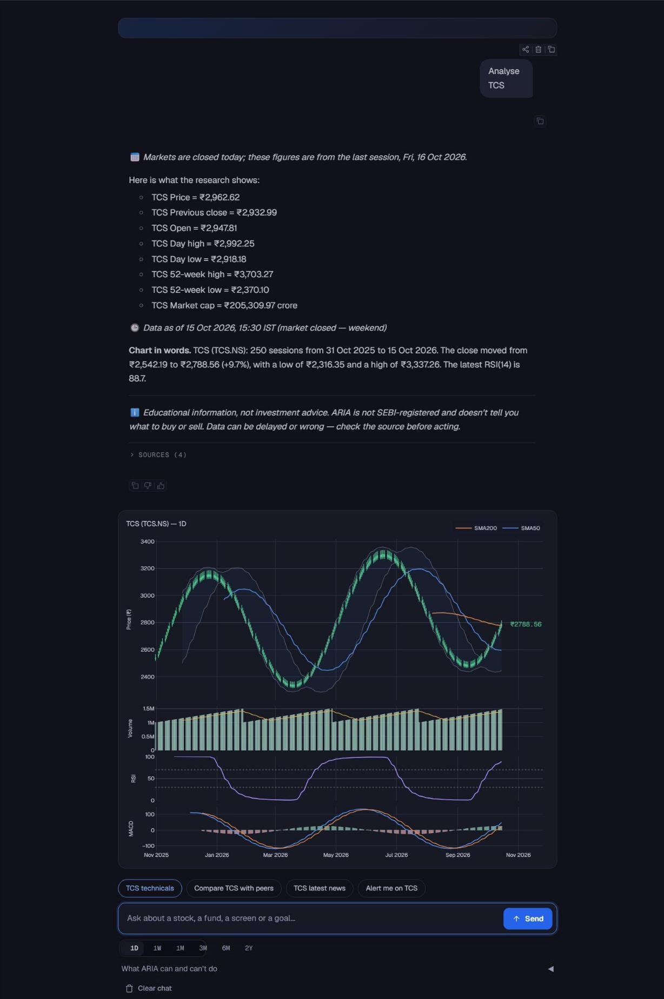

<div align="center">

# ARIA

**Autonomous Research & Investment Analyst for Indian markets**

Ask about any NSE/BSE stock or mutual fund in plain English. ARIA researches it, checks its own work, and answers with sources you can trace.

[](https://github.com/champ475/ARIA-research-agent/actions/workflows/ci.yml)
[](https://github.com/champ475/ARIA-research-agent/releases)
[](LICENSE)


[Quick start](#quick-start) · [Features](#features) · [Usage](docs/USAGE.md) · [Deployment](docs/DEPLOYMENT.md) · [FAQ](#faq) · [Contributing](CONTRIBUTING.md)

</div>

---

> **ARIA is a research tool, not financial advice.** It is education-only: it will not tell you to buy, sell or hold a security, and it never promises returns. AI output can be wrong. See [LEGAL.md](LEGAL.md).

## What is ARIA?

ARIA is a self-hosted web app that works like a research analyst for Indian equity markets. You type a question. A multi-agent engine plans the research, pulls prices, fundamentals, news and fund data, verifies every claim against the evidence, and writes the answer. Each number links back to where it came from.

```text
You:   what is the PE ratio of TCS

ARIA:  The P/E ratio of TCS is 24.3 [^pe].

       Cited calculations
       [^pe] P/E Ratio
       24.3 = current price (₹4,127.50) / trailing EPS (₹169.85)

You:   what about its RSI

ARIA:  TCS's 14-day RSI is 58.2: neither overbought nor oversold.
```

Follow-ups work like a normal chat. "Its RSI" resolves to the company you were just discussing.



<sub>Screenshot from the offline demo mode (canned LLM, sample market data), so the figures are illustrative.</sub>

## Features

| | |
|---|---|
| **Equity research** | Fundamentals (lender-aware: no ROCE or D/E for banks and NBFCs), technicals (RSI, MACD, Bollinger Bands, moving averages), news and sentiment, charts, peer comparison, a 0–100 risk profile, and MA-crossover and RSI backtests with trading costs. Answers stream live. |
| **IC-style reports** | Initiating coverage, result updates, sector thematics and quick notes. Download as PDF or Markdown, any time. |
| **Mutual funds** | NAV lookup, category comparison (large, mid and small cap, ELSS, debt, hybrid, index) with returns and risk metrics, SIP vs lumpsum explained. |
| **Stock screener** | Filter every NSE-listed stock by P/E, P/B, ROE, ROCE, D/E, dividend yield, growth, market cap and sector. Top gainers and losers, large deals, CSV export, saved screens. |
| **Price and technical alerts** | 14 condition types, delivered to your own Telegram chat. Checked every 5 minutes in market hours. |
| **Goal-based planning** | ARIA asks about your age, capital, horizon, goal and risk tolerance, remembers them, and builds an allocation grounded in real fund and stock data. |
| **Portfolio and watchlist** | Add holdings or import a Zerodha or Groww holdings CSV. Live P&L, allocation, and alerts on portfolio P&L. |
| **Cited and honest** | Every ratio links to its evidence. Thin data lowers the stated confidence. Unverified claims are withheld or flagged. |
| **Your account, your data** | Email verification, password reset, log out other devices, export all your data as JSON, delete your account. |
| **Bring your own LLM key** | 5 free questions a day on the operator's keys, then any OpenAI-compatible provider (OpenAI, Groq, OpenRouter, Together, Fireworks, Ollama and more). Keys are encrypted at rest. |
| **Accessible** | Light and dark themes, WCAG 2.1 AA contrast, keyboard navigation, charts described in words. |

See [docs/USAGE.md](docs/USAGE.md) for example prompts for every feature.

## Quick start

### With Docker (recommended)

You need [Docker](https://docs.docker.com/get-docker/) with Compose. Nothing else: Compose starts the app, a background worker and a Postgres database.

```bash
git clone https://github.com/champ475/ARIA-research-agent.git
cd ARIA-research-agent
cp .env.example .env
```

Open `.env` and set two things:

```bash
# Any random string of 32+ characters
SECRET_KEY=...        # python -c "import secrets; print(secrets.token_urlsafe(32))"

# At least one LLM key for answers (both are free)
GROQ_API_KEY_1=...    # https://console.groq.com/keys
GEMINI_API_KEY=...    # https://aistudio.google.com/apikey
```

Start it:

```bash
docker compose up --build
```

Open **http://localhost:7860**, sign up, and ask a question. Your data lives in a Docker volume and survives restarts.

> In the default `dev` mode the email-confirmation link is printed in the app log (`docker compose logs app`) instead of being mailed.

### Without Docker

You need Python 3.11+ and a Postgres database (a free [Neon](https://neon.tech) project works).

```bash
git clone https://github.com/champ475/ARIA-research-agent.git
cd ARIA-research-agent
python -m venv venv && source venv/bin/activate   # Windows: venv\Scripts\activate
pip install -r requirements.txt
cp .env.example .env                              # set DATABASE_URL, SECRET_KEY, an LLM key
python scripts/migrate.py                         # create the database schema
python app.py                                     # http://localhost:7860
```

The app checks its configuration at start-up and, if anything is wrong, exits with one readable list of what to fix.

### Try it offline (no keys, no network)

Want to look around before getting any API keys? Run with the built-in fake LLM and recorded market data:

```bash
ARIA_FAKE_LLM=1 ARIA_FAKE_DATA=1 python app.py
```

Answers are canned, so this is for exploring the interface only.

## Configuration

All settings live in `.env`, and `.env.example` documents every one. The ones most people touch:

| Setting | Needed? | What it does |
|---|---|---|
| `SECRET_KEY` | Yes | 32+ random characters. Encrypts users' own LLM keys. |
| `DATABASE_URL` | Yes (not with Docker) | Postgres connection string. |
| `GROQ_API_KEY_1` … `_5`, `GEMINI_API_KEY` | One or more | Powers the free daily questions. Skip them and every user brings their own key. |
| `TELEGRAM_BOT_TOKEN`, `TELEGRAM_BOT_USERNAME` | For alerts | One bot serves all users. Setup in [docs/ALERTS.md](docs/ALERTS.md). |
| `MAIL_BACKEND`, `SMTP_*` | For real email | Defaults to printing emails to the log. |
| `LOCAL_LLM_BASE_URL` | Optional | Last-resort local model (llama.cpp, Ollama, LM Studio). |

**Free questions vs your own key.** Every signup gets 5 free questions a day on the operator's Groq and Gemini keys. After that, or from the start if the operator set no keys, each user pastes their own key under **Settings** in the app.

## Using ARIA

Type what you want. There are no commands and no modes to pick. ARIA works out whether you are asking about a stock, a fund, a screen, an alert or a plan.

```text
Analyse TCS
Compare HDFC Bank vs ICICI Bank
Generate an IC report for RELIANCE
Stocks with PE below 20 and ROE above 15
Alert me if TCS drops below 3500
Compare large cap funds
Help me plan for retirement in 20 years
```

The app has five tabs: **Chat**, **Watchlist**, **Portfolio**, **Alerts** and **Settings**. Operators also get an **Admin** tab.

Full guide with more prompts and how alerts behave: [docs/USAGE.md](docs/USAGE.md).

## How it works

```text
question ─► understand ─► plan ─► research (parallel) ─► summarise ─► verify ─► answer
            intent,       pick     prices, fundamentals,  distil      check      streamed,
            company       tools    news, funds, screens   evidence    claims     with citations
```

1. **Understand.** Works out the intent and resolves company names against the full NSE and BSE instrument list. It never trusts a guessed ticker.
2. **Plan and research.** Chooses the tools the question needs and runs them in parallel.
3. **Verify.** Checks the numbers in the draft against the collected evidence. Bad claims are withheld or flagged, and ARIA asks you before going ahead on thin data.
4. **Answer.** Writes the response, streams it, and attaches sources and a confidence level.

Built with Python, [LangGraph](https://github.com/langchain-ai/langgraph), [Gradio](https://www.gradio.app/), FastAPI and Postgres. Market data comes from Yahoo Finance, NSE, AMFI and public news feeds. Design details: [ARCHITECTURE.md](ARCHITECTURE.md).

## FAQ

**Is it free?** The software is MIT licensed. Data sources are free public ones. LLM calls use free-tier Groq and Gemini keys, or your own key.

**Which markets does it cover?** Indian equities on NSE and BSE, and Indian mutual funds. No US stocks, crypto or derivatives.

**Does it give buy or sell recommendations?** No. ARIA is education-only. Requests for personal picks are reframed, and every answer carries a disclaimer. See [docs/ADVICE_POLICY.md](docs/ADVICE_POLICY.md).

**Can I trust the numbers?** They come from public sources and are cited, but free data can be delayed, incomplete or wrong, and AI can misread it. Check anything important at the source.

**Where does my data go?** To your own Postgres database. If you use your own LLM key, your questions go to that provider. See [docs/PRIVACY.md](docs/PRIVACY.md).

**Do alerts work when my computer is off?** Yes, if you host the worker somewhere that stays up, or use the included GitHub Actions checker. See [docs/ALERTS.md](docs/ALERTS.md).

**Can I run it for other people?** Yes. Read [docs/DEPLOYMENT.md](docs/DEPLOYMENT.md) and [LEGAL.md](LEGAL.md) first, and adjust the terms to your setup.

## Documentation

| | |
|---|---|
| [Usage guide](docs/USAGE.md) | Example prompts for every feature |
| [Alerts setup](docs/ALERTS.md) | Telegram bot and background checks |
| [Deployment](docs/DEPLOYMENT.md) | Docker, Hugging Face Spaces, workers, admin access |
| [Docs index](docs/README.md) | Operations, security, privacy, data sources |
| [Architecture](ARCHITECTURE.md) | Design decisions and trade-offs |
| [Changelog](CHANGELOG.md) | What changed in each release |

## Contributing

Bug reports, ideas and pull requests are welcome. Start with [CONTRIBUTING.md](CONTRIBUTING.md), which covers the dev setup, tests and project layout. Please follow the [Code of Conduct](CODE_OF_CONDUCT.md).

Found a security problem? Report it privately: [docs/SECURITY.md](docs/SECURITY.md).

## Data sources

Data: Yahoo Finance (via yfinance), NSE, BSE, AMFI, mfapi.in, Google News and publisher RSS. These are free public sources, used for non-commercial, education-only research. Each one's terms, permitted use and attribution are in [docs/DATA_SOURCES.md](docs/DATA_SOURCES.md). Before any commercial use, read that register's status column: NSE and Yahoo data need a licence.

## License

[MIT](LICENSE) © Arnav Mendiratta. Terms of use and privacy notice for people using an instance: [LEGAL.md](LEGAL.md).
