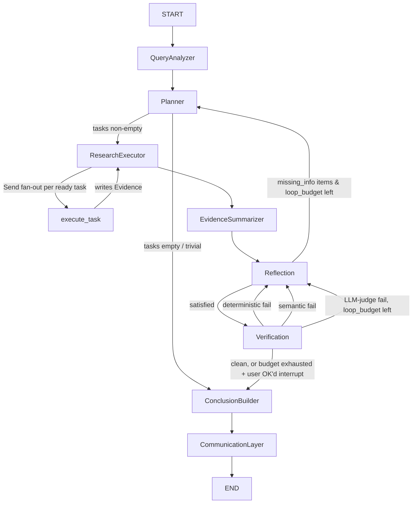

# RFC: ARIA as an Autonomous Financial Research Graph

Status: **Proposal — not implemented.** No code changes accompany this document.
Author: Claude Code, on behalf of the ARIA maintainer
Branch context: `feature/analyst-trust-reliability`
Supersedes in intent (not in code): `langchain-langgraph-migration` branch, see `ARIA_LANGGRAPH_MIGRATION_REPORT.md`

## 1. Motivation

ARIA today is a well-built **chatbot with tools**: a keyword router picks one of six specialist
agents, that agent fetches data, calls one LLM synthesis call (streamed for equity, non-streamed
elsewhere), and returns markdown + chart. Every agent re-implements its own prompt, its own
notion of "confidence," and its own control flow. There is no mechanism for the system to notice
it under-answered a question, no mechanism to check its own numbers before showing them to the
user, and no way to work on more than one sub-question in a single turn.

A prior branch (`langchain-langgraph-migration`) added LangGraph but only as a routing shim —
`StateGraph` nodes are `route` + one node per tab, mirroring `Orchestrator.route()` 1:1. That
branch adds a dependency without adding a capability. This RFC is the alternative: keep the graph
shape but make the graph *represent research*, not dispatch.

## 2. Current architecture (ground truth)

- **Routing**: `Orchestrator.route()` (`agents/orchestrator.py:73`) scores the message against
  hardcoded keyword lists (`_REPORT_KW`, `_SCREENER_KW`, `_MF_KW`, `_ALERT_KW`, `_PLANNING_KW`),
  defaults silently to `"equity"` if nothing matches. Misroutes are invisible — a query that
  doesn't hit a keyword list is treated as an equity question with no signal to the user.
- **Agents**: `equity_agent.py`, `report_agent.py`, `mf_agent.py`, `screener_agent.py`,
  `alert_agent.py`, `planning_agent.py` — each owns its own `LLMClient` and system prompt.
  `base_agent.py` is dead weight; nothing subclasses it.
- **Equity flow** (`equity_agent.py:83` `process_stream`): parses intent → `_fetch_bundle()`
  (`equity_agent.py:184`, parallel `ThreadPoolExecutor` fetch across OHLCV/financials/macro/PDF/
  news) → computes technicals/fundamentals/risk/sentiment → assigns a coarse
  `confidence: High/Medium/Low` (`equity_agent.py:257`) → one LLM streaming call → post-hoc
  `_grounding_note()` (`equity_agent.py:359`) regex-checks numbers in the output against the
  bundle *after generation* and appends a warning banner if it doesn't like what it sees.
- **Other agents** don't stream and don't have an equivalent grounding pass.
- **Tools already exist and are good** — `tools/data/{fetcher,nse_scraper,news_fetcher,amfi,
  pdf_scraper,cache}.py`, `tools/analysis/{technical,fundamental,risk,backtester,sentiment}.py`,
  `tools/charts/builder.py`. `fundamental.py` already produces citable footnotes
  (`[^pe]`-style). None of this needs to be rewritten — it needs to be called by a planner
  instead of by hand inside `equity_agent.py`.
- **Persistence**: Postgres (Neon), raw SQL via `psycopg2` + `ThreadedConnectionPool`
  (`utils/db.py:20`), no ORM. Tables include `portfolio`, `watchlist`, `alerts`, `reports`,
  `saved_screeners`, `pdf_cache`, `chat_sessions`/`chat_history`, `financial_profiles` (JSONB,
  used by `PlanningAgent`).
- **No LangGraph in production code today.** `requirements.txt` has no `langgraph`/`langchain*`.

This is the baseline the proposal below improves on, and every claim in §10 is a claim against
*this* baseline, not a strawman.

## 3. Goals / non-goals

**Goals**: iterative, self-checking research; parallel task execution; evidence that exists as a
structured object before it becomes prose; a system that can say "I don't have enough to answer
that" instead of guessing; one confidence/grounding mechanism instead of six ad hoc ones.

**Non-goals**: rewriting the data/analysis tool layer (reused as-is), replacing Postgres, building
a new UI, achieving this in one PR. This is an incremental migration (§13).

## 4. Graph overview



Every node writes one entry to `research_journal` on exit (§5, §7) — the graph's own audit trail,
independent of what ends up in the user-facing report.

Loops are bounded by `loop_count < max_loops` (default 2) — not by hoping the LLM stops asking
for more evidence. This is the safety valve that makes "loop back into execution" not turn into
an infinite bill.

## 5. Graph state

```python
class Evidence(TypedDict):
    id: str                    # hash(source, entity, evidence_type, args)
    source: str                # "yfinance" | "nse_bhavcopy" | "pdf_scraper" | "news_rss" | "amfi"
    tool: str                  # fully-qualified tool function name that produced it
    entity: str                # ticker / fund code / sector
    evidence_type: str         # "price_ohlcv" | "fundamental_ratio" | "technical_indicator"
                                # | "news_headline" | "pdf_extract" | "macro" | "risk_flag"
    payload: dict
    timestamp: datetime
    confidence: float          # source reliability x freshness, not the old High/Med/Low enum
    citation_key: str          # reuses tools/analysis/fundamental.py cited_footnotes() convention

class Task(TypedDict):
    id: str
    description: str
    tool: str
    entity: str
    depends_on: list[str]
    status: Literal["pending", "running", "done", "failed", "skipped"]
    result_evidence_ids: list[str]

class ResearchPlan(TypedDict):
    objective: str
    tasks: list[Task]
    complexity: Literal["simple", "moderate", "complex"]

class VerificationIssue(TypedDict):
    claim: str
    issue_type: Literal["unsupported", "contradiction", "low_confidence", "missing_citation"]
    stage: Literal["deterministic", "semantic", "llm_judge"]   # which cascade stage caught it, §6
    evidence_ids: list[str]

class MissingInfoItem(TypedDict):
    # Reflection's output is this, not a prose sentence — makes Reflection deterministic
    # to consume: Planner turns each item directly into a Task, no re-interpretation step.
    missing: str            # e.g. "Quarterly earnings"
    reason: str              # e.g. "Needed for revenue trend"
    priority: Literal["high", "medium", "low"]
    action: str               # e.g. "Fetch filing" — names a tool from the catalogue (§6 Planner)

class Conclusion(TypedDict):
    # Output of ConclusionBuilder: a decided fact, before any LLM phrases it.
    claim: str
    value: Any
    confidence: float
    evidence_ids: list[str]
    citation_key: str

class JournalEntry(TypedDict):
    node: str
    decision: str
    reason: str
    timestamp: datetime

class GraphState(TypedDict):
    messages: Annotated[list, add_messages]
    query: str
    entities: list[str]
    intent: str
    objective: str
    complexity: str
    plan: ResearchPlan
    tasks: Annotated[list[Task], upsert_by_id]
    evidence: Annotated[list[Evidence], append_dedup]
    evidence_summary: dict          # EvidenceSummarizer output, what Reflection actually reads
    missing_info: list[MissingInfoItem]
    verification_issues: list[VerificationIssue]
    conclusions: list[Conclusion]   # ConclusionBuilder output, what CommunicationLayer reads
    loop_count: Annotated[int, operator.add]
    max_loops: int
    confidence_summary: dict
    research_journal: Annotated[list[JournalEntry], operator.add]
    final_report: str
    chart_html: str
```

## 6. Nodes

**QueryAnalyzer** — one cheap LLM call (`gemma2-9b-it`, `TOKENS_FAST`). Extracts entities via the
existing `utils.helpers.extract_all_entities`/`resolve_query` deterministic-first path (reused,
not replaced — it already handles alias resolution like SBI→SBIN), classifies intent and research
objective, estimates complexity. Replaces `Orchestrator.route()`'s silent-default keyword scoring
with an explicit classification the rest of the graph can act on (e.g. route ambiguity becomes a
`missing_info` entry instead of a silent wrong guess).

**Planner** — structured-output LLM call that turns objective + entities into a `ResearchPlan`:
a task list with tool bindings and `depends_on` edges. Tools available to the planner are the
existing functions in `tools/data/*` and `tools/analysis/*`, registered as a typed catalogue (name,
args schema, cost estimate). Complexity from QueryAnalyzer lets the planner skip tool execution
entirely for trivial turns ("what's RSI mean?") — routes straight to ReportGenerator. This is the
concrete answer to "avoid unnecessary tool execution": the current system always fetches+computes
the full bundle regardless of what was actually asked (`equity_agent.py:184`).

**ResearchExecutor** — computes the ready set (tasks whose `depends_on` are all `done`), fans them
out in parallel via LangGraph `Send`, one `execute_task` invocation per task. Before calling a
tool, checks the evidence cache (§8) for a non-stale match and reuses it instead of refetching —
this is what turns the reflection loop from "refetch everything again" into "fetch only the gap."

**execute_task** — thin adapter: calls the bound tool function from `tools/data`/`tools/analysis`
with the task's args, wraps the result as one or more `Evidence` objects, writes them back through
the `append_dedup` reducer.

**EvidenceSummarizer** — deterministic (no LLM) aggregation step between ResearchExecutor and
Reflection: groups `evidence` by `(entity, evidence_type)`, keeps latest value + confidence per
group, drops full raw payloads down to the fields Reflection actually needs. Exists because
Reflection reading 200 raw `Evidence` objects directly makes the Reflection prompt balloon and
degrades recall as evidence accumulates across loop iterations. Writes `evidence_summary`, which
is what Reflection actually reads — never the raw `evidence` list.

**Reflection** — LLM call that reads `plan.objective`, `evidence_summary` (not raw evidence), and
the original `query`. Output is **structured, not prose** — a list of `MissingInfoItem`, each with
`missing` / `reason` / `priority` / `action`, e.g.:

```
missing: "Quarterly earnings"
reason:  "Needed for revenue trend"
priority: high
action:  "Fetch filing"
```

This is the concrete fix for "Reflection returns 'need more data'" as an unparseable sentence —
Planner consumes `MissingInfoItem.action` directly to bind a new `Task`, no re-interpretation LLM
call in between. Deterministic in the sense that the same `evidence_summary` + `query` reliably
produces the same task, not that the LLM call itself is removed. Has no equivalent today — the
current pipeline has exactly one shot at being complete.

**Verification** — a cascade, cheapest check first, escalating only on failure (this runs before
generation, unlike `_grounding_note()` which runs after):

1. **Deterministic** — schema validation (does every `Evidence` have required fields), does cited
   evidence actually exist in state, numeric consistency (e.g. sums/ratios that should reconcile
   given `tools/analysis/fundamental.py`'s own formulas).
2. **Semantic** — contradiction detection: two `Evidence` entries for the same
   `(entity, evidence_type)` disagreeing beyond a tolerance; confidence-floor check.
3. **LLM judge** — only invoked for claims that survive stages 1-2 unresolved (ambiguous
   phrasing, a claim that needs judgment to tell if it's actually supported). This is the expensive
   path and, by design, the rarest one.

Each stage's failures become `VerificationIssue`s tagged with `stage`, and loop back to Reflection.
This ordering is the direct mitigation for the latency/cost risk in §17 — most turns should never
reach stage 3.

**ConclusionBuilder** — deterministic assembly, not an LLM call. Takes verified evidence and
produces `Conclusion` objects: `claim` + `value` + `confidence` + `citation_key`, one per thing the
plan's objective needed answered. This is where "what is true" gets decided — by evidence and
arithmetic, not by a model. Mirrors `tools/analysis/fundamental.py`'s existing practice of
recomputing ratios from raw financials rather than trusting an upstream-provided number; extends
that discipline to the whole report instead of just fundamentals.

**CommunicationLayer** — the only node that produces user-facing prose, and the only one allowed
to call the primary model (`llama-3.3-70b-versatile`, `TOKENS_SYNTHESIS`/`TOKENS_COMPLEX`). Takes
`conclusions` only — never raw evidence, never tool output — and phrases them, attaches
`confidence_summary` per conclusion, renders the chart (`tools/charts/builder.py`, reused as-is).
Its job is explanation, not decision: it cannot introduce a number that isn't already sitting in a
`Conclusion`, because that's the only thing in its input. This is a stricter version of §15's
original grounding claim — splitting decide (ConclusionBuilder) from explain (CommunicationLayer)
means the LLM has no path to inventing a number even in principle, not just in practice.

## 7. Reducers

- `append_dedup` (evidence): append; drop if an existing entry has the same
  `(source, entity, evidence_type, args-hash)` and is within its TTL (§8) — this *is* the cache-
  reuse mechanism, not a separate lookup.
- `upsert_by_id` (tasks): merge by `id` so Reflection-generated tasks add to the list without
  resetting status on already-`done` tasks.
- `operator.add` (loop_count): plain increment, compared against `max_loops` in the conditional
  edge functions — the loop's only exit-independent safety bound.
- `verification_issues`: full replace each Verification pass (issues are re-derived from current
  evidence each time, not accumulated).
- `research_journal`: `operator.add` (append-only). Every node appends exactly one `JournalEntry`
  (`node`, `decision`, `reason`, `timestamp`) on exit — e.g. Planner logs `decision="skip
  ResearchExecutor"`, `reason="complexity=simple, no tasks needed"`. Purpose is debugging and
  replay: given a `thread_id`, the journal reconstructs *why* the graph did what it did, independent
  of the final report text. Never read by any node — write-only from the graph's perspective, read
  by humans/tooling.

## 8. Evidence cache / reuse

Extends `tools/data/cache.py`'s existing Parquet-cache pattern rather than replacing it: a new
`evidence_cache` layer keyed by `(tool, args-hash)` with a **per-evidence-type TTL** — OHLCV 15 min,
fundamentals 1 day, news 1 hr, macro 1 hr — stored in Postgres (JSONB) so it survives across the
Reflection→Planner loop within a turn *and* across turns/sessions. `ResearchExecutor` checks this
before calling `execute_task`.

## 9. Conditional edges

```
QueryAnalyzer -> Planner                                   (always)
Planner -> ConclusionBuilder                                (tasks == [])
Planner -> ResearchExecutor                                 (tasks != [])
ResearchExecutor -> EvidenceSummarizer                       (all ready tasks done or failed)
EvidenceSummarizer -> Reflection                             (always)
Reflection -> Planner                                        (missing_info != [] and loop_count < max_loops)
Reflection -> Verification                                   (missing_info == [] or loop_count >= max_loops)
Verification -> Reflection                                   (any-stage issues != [] and loop_count < max_loops)
Verification -> ConclusionBuilder                            (issues == [] or loop_count >= max_loops)
ConclusionBuilder -> CommunicationLayer                      (always)
```

Budget-exhausted-with-open-issues is not silently swallowed — it's surfaced to ConclusionBuilder as
a lower-confidence `Conclusion` (and from there into `confidence_summary`, "could not verify X")
rather than either infinite-looping or lying. Verification's three internal stages (§6) don't need
separate graph edges — they're sequential checks inside one node invocation; only a full-stage
failure produces a loop-back edge.

## 10. Example execution flow

Query: *"Compare RELIANCE and TCS fundamentals and set an alert if RELIANCE drops below 2800."*

1. QueryAnalyzer: entities=[RELIANCE, TCS], intent="compare+alert", complexity="moderate".
2. Planner: 5 tasks — fetch fundamentals(RELIANCE), fetch fundamentals(TCS) [independent, parallel],
   compute risk(RELIANCE), compute risk(TCS) [depend on their fundamentals fetch], create_alert
   (RELIANCE, <2800) [independent].
3. ResearchExecutor: fans out the 3 ready tasks (2 fetches + alert creation) via `Send`, then the
   2 risk computations once their dependencies resolve.
4. EvidenceSummarizer: collapses the 5 evidence entries to per-entity summaries.
5. Reflection: objective covered — comparison data for both tickers present, alert created.
   `missing_info = []`. Journal entry: `decision="proceed to Verification"`,
   `reason="all plan tasks done, no gaps found"`.
6. Verification: stage 1 (schema/citation) passes for both tickers, stage 2 (contradiction/
   confidence-floor) passes, stage 3 (LLM judge) never invoked. Clean.
7. ConclusionBuilder: two `Conclusion` objects (RELIANCE fundamentals, TCS fundamentals) plus one
   confirming the alert was created.
8. CommunicationLayer: renders comparison table with footnotes + confirms alert creation, one LLM
   call.

Today's system would route this whole message to exactly one tab (probably `equity`, since
`_ALERT_KW` might not fire alongside comparison language) and silently drop the alert half. That
class of bug is structurally impossible once tasks are planned as an explicit list rather than
inferred from which single keyword list matched hardest.

## 11. Failure recovery

- **Tool failure** (`execute_task` raises, e.g. yfinance degraded): task marked `failed`, existing
  `fetcher.py` fallback to NSE bhavcopy still applies inside the tool call itself (reused, not
  reimplemented); if the tool has no fallback, Reflection sees the gap as `missing_info` and either
  retries via an alternate tool binding or surfaces the gap to the report as a stated limitation.
- **LLM provider failure**: unchanged — `LLMClient`'s existing Groq→Gemini fallback and
  `_KeyRotator` (`agents/llm_client.py`) sit underneath every node's model call; the graph doesn't
  need its own retry logic for this layer.
- **Loop non-convergence**: bounded by `max_loops`; on exhaustion the graph proceeds to
  ReportGenerator with open issues disclosed rather than looping forever or crashing.
- **Checkpointed resume**: since state is checkpointed (§12), a crash mid-graph resumes from the
  last completed node on retry instead of restarting the whole research process.

## 12. Human-in-the-loop checkpoints

Implemented via LangGraph `interrupt()` + a Postgres checkpointer (new table, reuses the existing
`utils/db.py` connection pool rather than a second DB connection):

- **Before ResearchExecutor**, when `complexity == "complex"` and task count exceeds a threshold
  (expensive multi-ticker PDF scraping, screener runs) — ask the user to confirm before spending
  the calls.
- **Before ConclusionBuilder**, when Verification exhausts `max_loops` with unresolved
  `VerificationIssue`s — surface "I couldn't verify X, show anyway?" rather than deciding silently.
- **In planning-intent turns**, before finalizing a capital allocation touching real money — an
  explicit confirm step, replacing `PlanningAgent`'s current implicit two-phase state machine with
  an explicit interrupt the UI can render as a button.

The Gradio UI resumes the graph by feeding the response back in as the `Command(resume=...)`
value against the persisted `thread_id`.

## 13. Memory model

- **Graph checkpoint** (new): LangGraph Postgres checkpointer, `thread_id` = chat session id,
  persists `GraphState` for resumability and interrupts. Separate concern from —
- **Chat transcript** (existing, unchanged): `chat_sessions`/`chat_history` tables stay as the
  human-readable sidebar history the UI renders; not repurposed as graph state.
- **Evidence cache** (new, §8): cross-turn reuse of fetched/computed evidence, TTL'd per type.
- **User profile memory** (existing, unchanged): `financial_profiles` JSONB table stays exactly as
  `PlanningAgent` uses it today; QueryAnalyzer/Planner read it as long-term context when
  intent implies planning, instead of `PlanningAgent` owning its own intake state machine.

## 14. What gets deleted / reduced

- `agents/base_agent.py` — dead code, remove.
- `agents/orchestrator.py`'s keyword routing — replaced by QueryAnalyzer's classification.
- Six specialist agent classes collapse into: 9 node functions (§6) + a tool catalogue that wraps
  the *existing* `tools/data`/`tools/analysis` functions directly (no rewrite of those modules).
  Of the 9, only 3 call an LLM at all (QueryAnalyzer, Planner, Reflection) plus a conditional 4th
  (Verification's LLM-judge stage) and CommunicationLayer — EvidenceSummarizer and
  ConclusionBuilder are plain code.
- `alert_agent.py`'s CRUD becomes a small set of tools (`create_alert`, `list_alerts`, ...)
  callable by ResearchExecutor like any other task — `scripts/check_alerts.py`'s separate
  condition-evaluation cron is untouched, it already doesn't go through the agent layer.
- `equity_agent.py`'s `_grounding_note()` regex heuristic is superseded by Verification and can be
  deleted once Verification is live (§13/Phase 3 below) — not before, so grounding coverage never
  regresses mid-migration.

## 15. Why this is better than the current implementation

- **Routing correctness**: today, an unmatched message silently becomes an equity query
  (`orchestrator.py:73` default). QueryAnalyzer makes "I'm not sure what you're asking" an explicit
  state instead of a wrong guess.
- **Grounding**: today, a hallucinated number is checked *after* it's already in the streamed
  output (`equity_agent.py:359`), and the fix is a warning banner bolted onto text that already
  went out. In the new design, CommunicationLayer never sees raw evidence at all, only
  ConclusionBuilder's pre-decided `Conclusion` objects — the model has no path to introduce a
  number that wasn't already decided by deterministic code.
- **Verification cost**: a naive "run an LLM check on everything" verifier would multiply cost
  roughly 1:1 with report generation. The deterministic → semantic → LLM-judge cascade (§6) means
  the expensive stage only runs on claims that survive two cheap filters — most turns should never
  reach it.
- **Debuggability**: today, understanding why an agent answered the way it did means reading logs
  or re-running with breakpoints. `research_journal` is a structured, per-node decision trail
  persisted with the checkpoint — replaying *why* a past run behaved a certain way doesn't require
  re-running it.
- **Multi-part queries**: today, one message → one tab → one agent. A query needing two kinds of
  work (comparison + alert, or fundamentals + planning) loses the half that didn't match the
  strongest keyword bucket. The planner's task list has no such ceiling.
- **Unnecessary work**: today, `_fetch_bundle()` always fetches the full data set regardless of
  what was asked. The planner can choose not to generate tasks for data the objective doesn't need.
- **Streaming coverage**: today, only `EquityAgent` streams; the other five agents return one
  finished blob. Node-level state changes (plan, evidence-as-collected) give the UI something to
  show incrementally for every intent, not just equity.
- **Self-correction**: today there is no mechanism to detect a partial answer or a contradiction
  and go get more data. Reflection + Verification is a wholly new capability, not a refactor of an
  existing one.
- **One confidence/grounding mechanism instead of six**: today each agent (where it bothers at
  all) invents its own notion of confidence. Evidence-level `confidence` + `Verification` is
  computed once, structurally, for every intent.

## 16. Migration plan (incremental, not a rewrite)

- **Phase 0**: add `langgraph`/`langchain-core` deps, add Postgres checkpointer table, build the
  new graph behind a feature flag; old `Orchestrator` path stays live and default.
- **Phase 1**: implement QueryAnalyzer + Planner + a pass-through ConclusionBuilder/
  CommunicationLayer wired directly to existing `tools/data`/`tools/analysis` functions,
  single-ticker equity queries only — smallest slice that proves the Evidence schema and reducers
  (including `research_journal`) work end to end.
- **Phase 2**: add ResearchExecutor parallel `Send` fan-out + dependency ordering + EvidenceSummarizer
  + the evidence cache (§8).
- **Phase 3**: add Reflection (structured `MissingInfoItem` output) + Verification's deterministic
  and semantic stages; once their coverage is validated against real queries, delete
  `_grounding_note()`. LLM-judge stage of Verification ships last within Phase 3, since it's the
  one needing the most tuning against false-positive rate.
- **Phase 4**: extend the Planner's tool catalogue to cover report/mf/screener/alert/planning
  intents; retire each specialist agent one at a time behind the flag as its intent is covered.
  (a.k.a. "Phase 7" in code comments — `graph/graph.py`, `graph/tool_catalogue.py`,
  `agents/graph_orchestrator.py`, `graph/nodes/human_review.py`, `app.py` all refer to this same
  work as Phase 7, a repo-wide numbering that folds in the checkpointer/HITL/adapter work done
  after this RFC was written as phases 5-6 before circling back to this RFC's Phase 4. Code
  comments are canonical going forward; this document's own Phase 4/5 labels are kept as-is here
  for historical continuity rather than renumbered.)
- **Phase 5**: remove `Orchestrator` keyword routing, dead agent files, and the feature flag.

See `C:\Users\arnav\.claude\plans\for-the-above-identified-lazy-river.md` for the detailed
phase-by-phase (7.0-7.5) breakdown of this Phase 4/5 work.

## 17. Open risks

- **Latency/cost**: today's flow is ~1 LLM call per turn (streamed). This design is roughly
  4-6 LLM calls per turn in the worst case (analyze, plan, per-reflection-pass, LLM-judge stage,
  generate) — partially mitigated by the Verification cascade (§6), which keeps the LLM-judge
  stage off the common path, and by EvidenceSummarizer/ConclusionBuilder being plain code, not
  model calls. Route QueryAnalyzer/Reflection/Verification's LLM-judge stage through `gemma2-9b-it`
  (`TOKENS_FAST`) and reserve `llama-3.3-70b-versatile` for Planner/CommunicationLayer only — still
  needs measurement against Groq's 14,400 req/day/key ceiling and the existing `_KeyRotator`
  capacity before Phase 4.
- **Planner tool-binding correctness**: a bad plan (wrong tool, wrong args) fails silently unless
  Verification's "missing citation" check is strict enough to catch it — needs real-query tuning
  in Phase 3, not a first-guess threshold.
- **`Send`-based fan-out and LangGraph checkpointing together**: needs a concrete spike in Phase 2
  since interrupt/resume semantics under parallel branches are the least battle-tested part of the
  LangGraph API surface for this codebase's use case.

## 18. Deferred: evidence as a knowledge graph

The `evidence` list (§5) already makes tools the only thing that touches raw data — Planner,
Reflection, Verification, and ConclusionBuilder all consume `Evidence`/`evidence_summary`, never a
tool result directly. A further upgrade is replacing the flat list with an actual graph structure
(entities as nodes, relationships — "RELIANCE competes-with TCS", "TCS held-by fund X" — as edges),
which would let cross-entity queries (screener comparisons, sector rollups, portfolio-level
reasoning) traverse relationships instead of the Planner re-deriving them from scratch each turn.

Not scoped into Phase 0-5: it's a new persistence and query layer, not a state-shape change, and
§3 explicitly rules out scope growth beyond the incremental plan. Worth revisiting once Phase 4
exposes real cross-entity query patterns (comparison intents, screener intents) that a flat
evidence list handles clumsily — at that point the shape of the actual pain will tell us what the
graph schema needs to be, rather than guessing now.

Update (Phase 7.3): rather than wait for the full knowledge-graph rework, screener's cross-entity
comparison need is being solved narrowly first — tagging `Evidence` with a `comparison_group_id`
so `communication_layer` can render one coherent multi-entity table. The full graph-structured
evidence upgrade described above remains explicitly deferred; this is a local fix, not a
supersession of this section.

## 19. Phase 7.0 measurement results

Baseline measurement of LLM-calls/turn and latency for the current single-domain
(equity-only) graph, taken before Phase 7.1-7.3 add any new tool catalogue entries — see
§17's "Latency/cost" open risk, which this section exists to close out with real numbers
instead of estimates.

Methodology: `scripts/measure_graph_latency.py` runs a fixed set of representative equity
queries (mix of `complexity="simple"` and `complexity="complex"`, per `QueryAnalyzer`'s own
classification) through `build_graph()` end to end, counting LLM calls per node (via a
counting wrapper around each per-node `LLMClient`) and wall-clock per turn.

Fill in after running the script against a real (or recorded) Groq-backed graph:

| Query complexity | LLM calls/turn (avg) | Wall-clock/turn (avg) | Notes |
|---|---|---|---|
| simple | _TBD_ | _TBD_ | Planner short-circuits to no tasks (§ Planner, `complexity=="simple"`) |
| complex | _TBD_ | _TBD_ | Full plan → execute → reflect/verify loop |

Go/no-go for Phase 7.1+ domain expansion: _TBD — fill in once the table above is measured._
Re-measure after Phase 7.3 (all 6 domains + multi-intent fan-out wired) per the phased plan's
cross-cutting notes, since multi-domain Planner cross-products plausibly increase call count
beyond this single-domain baseline.
